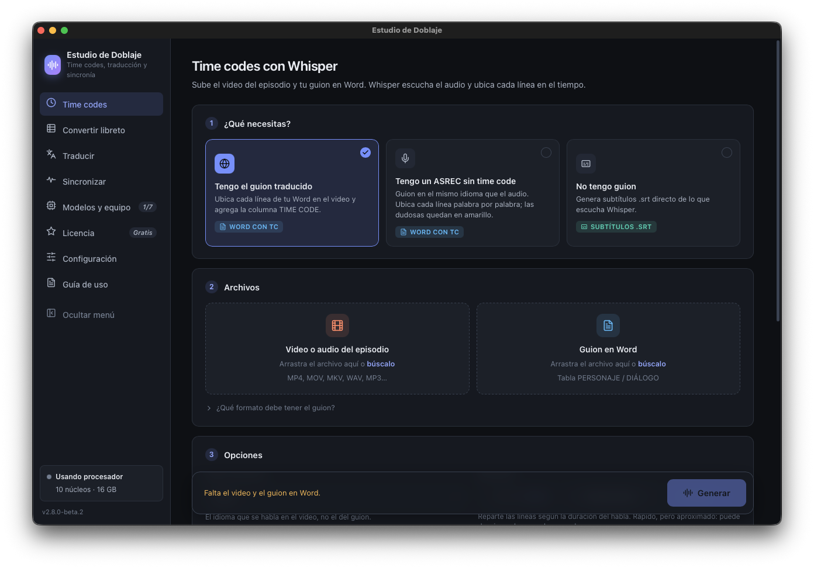

# Estudio de Doblaje · descargas

Aquí se publican los instaladores de **Estudio de Doblaje**, la app de escritorio para traductores de doblaje: time codes con Whisper, traducción sin internet con modelos locales y sincronización de guiones. Este repositorio no tiene código; solo guarda los *releases*.

Para saber qué hace la app, visita el [sitio](https://sunkpoet-lang.github.io/estudio-de-doblaje/), que incluye la guía de uso en español y en inglés.

*Versión 2.8.0-beta.2 en macOS (Apple Silicon), pantalla de Time codes.*

## Descargar

Ve a **[Releases](https://github.com/sunkpoet-lang/estudio-de-doblaje-descargas/releases/latest)** y baja el archivo de tu sistema:

| Sistema | Archivo | Cómo se instala |
|---|---|---|
| **Windows 10/11** | `EstudioDeDoblaje-Setup-X.Y.Z.exe` | Doble clic. |
| Mac (Apple Silicon) | `EstudioDeDoblaje-X.Y.Z-macOS.zip` | Descomprimir y, la primera vez, clic derecho en la app → **Abrir**. |
| Linux | `EstudioDeDoblaje-X.Y.Z-Linux.tar.gz` | Descomprimir y correr `GuionTimecodes/GuionTimecodes`. |

> Windows puede mostrar «Windows protegió su PC» porque el instalador no está firmado: elige **Más información → Ejecutar de todas formas**.

La versión estable más reciente se marca como *Latest*. Las versiones `-beta.N` son de prueba (*pre-release*) y pueden traer fallos.

## Qué más hay en los *releases*

- **`motor-whisper-X.Y.Z`:** el motor de Whisper (whisper.cpp con Vulkan) para GPUs AMD, Intel e integradas. No es una versión de la app: la app lo descarga sola desde **Modelos y equipo → Activar GPU**.

## Actualizar

La app avisa en la barra lateral cuando hay una versión nueva. Tus modelos, perfiles y glosarios se conservan al actualizar, porque viven en la carpeta de datos del usuario y no en la de instalación.

## Ayuda

Si algo falla, abre la app y entra a **Modelos y equipo → Copiar diagnóstico**; copia un resumen de tu equipo y de los últimos errores para pegarlo al pedir ayuda. No incluyas material de clientes (guiones, videos, audios): puede estar bajo acuerdo de confidencialidad.

## Licencia

El núcleo de la app es software libre bajo la **GNU General Public License v3.0**. El módulo Pro que trae el instalador oficial es cerrado y se rige por sus propios términos. whisper.cpp se distribuye bajo licencia MIT, que va incluida en su paquete. Los modelos de Whisper y de traducción tienen sus propias licencias: consulta la tarjeta de cada uno en Hugging Face.

---

*Copyright © 2026 Daniel Barreto.*
